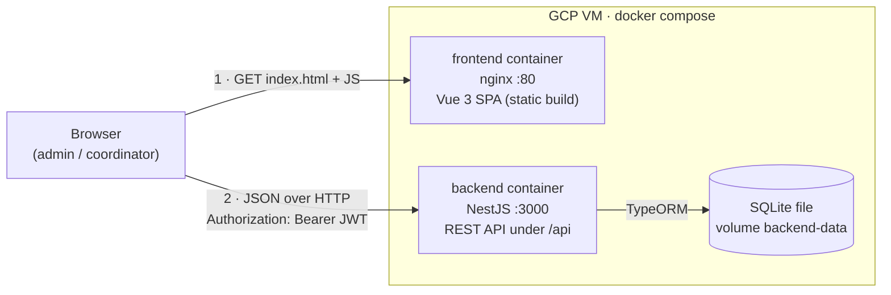
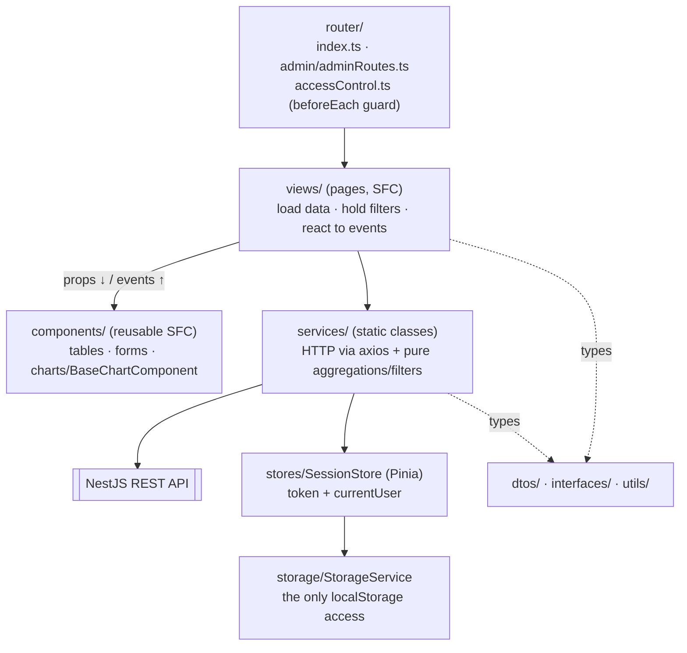
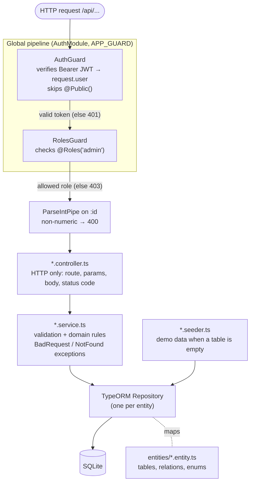
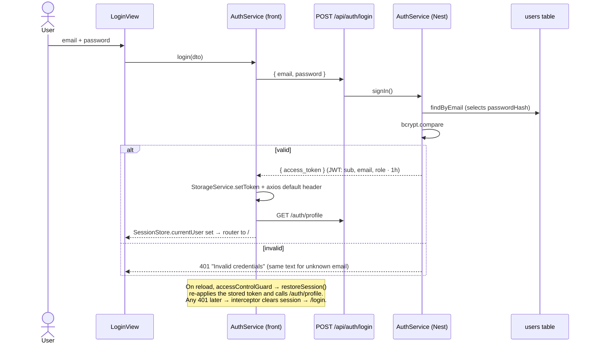
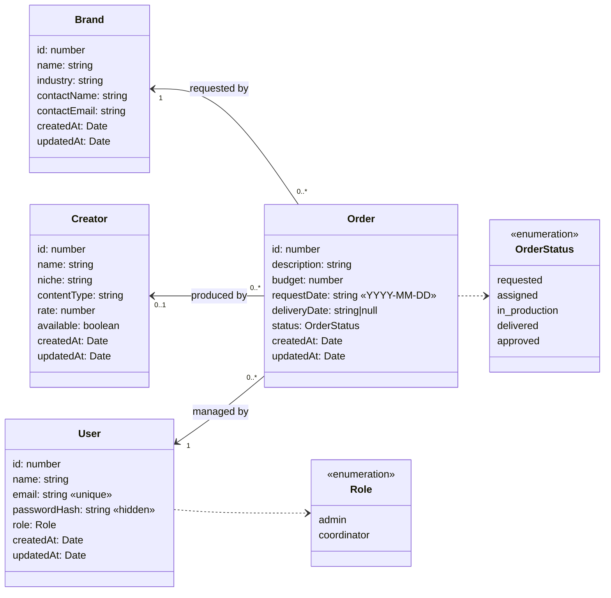

# Architecture

This page explains how Creatorly is built, layer by layer, and lists honestly what is **not perfect yet**. It is the text companion of the four images in [Deliverable 2](https://github.com/kepabonsaeafit/creatorly/wiki/Deliverable-2): the diagrams below are written in Mermaid (GitHub renders them), so they can be updated in the same commit as the code they describe.

Decisions and their reasons live in the ADRs ([`docs/adr/`](https://github.com/kepabonsaeafit/creatorly/blob/main/docs/adr)): persistence and login in [ADR-0005](https://github.com/kepabonsaeafit/creatorly/blob/main/docs/adr/0005-backend-nestjs-sqlite-y-login-jwt.md), deployment in [ADR-0006](https://github.com/kepabonsaeafit/creatorly/blob/main/docs/adr/0006-despliegue-con-docker-compose-multi-stage.md). The domain vocabulary (Creator, Brand, Order, Coordinator...) is defined in [`CONTEXT.md`](https://github.com/kepabonsaeafit/creatorly/blob/main/CONTEXT.md).

---

## 1. System overview

- **Two containers** (`docker-compose.yml`). nginx only serves files: the compiled SPA runs **in the browser**, so the browser talks to the API directly (step 2). nginx's `try_files ... /index.html` lets Vue Router handle deep links like `/orders/3`.
- **The API URL is baked into the bundle at build time** (`VITE_API_BASE_URL`, a Docker build arg), which is why `deploy.sh` rebuilds the frontend whenever the VM IP changes.
- **SQLite** lives in a named volume, so data survives `docker compose up --build`. `docker compose down -v` resets the demo data.
- **Local development** runs the same two processes without Docker: `npm run dev` (Vite :5173) and `npm run start:dev` (Nest :3000).

## 2. Frontend (Vue 3 SPA): layers

| Layer | Responsibility | Must NOT |
|---|---|---|
| `router/` | Maps URLs to views; `accessControlGuard` restores the session and blocks `/login` when logged in, any page when logged out, and `meta.admin` pages for coordinators. **Runs on every navigation, including a typed URL.** | Be the only protection: the backend checks again (section 3). |
| `views/` | One page each. Loads data on `onMounted`, keeps the filter state (`reactive`/`ref`), shows the loading, empty and error states. | Call axios directly or touch `localStorage`. |
| `components/` | Presentational and reusable: receive data through **props** and report actions through **emits** (`@delete`, `@submit`). `BaseChartComponent` wraps Chart.js once; the four chart components only map DTOs to datasets. | Fetch data. |
| `services/` | One class per resource. `getAll/getById/create/update/remove` are the **only** HTTP calls. Static pure methods (`filter`, `getOrdersByStatus`, `getStats`...) do the filtering and report aggregation. | Hold state. |
| `stores/SessionStore` | The **only** Pinia store left after ADR-0005: the token and the logged-in user. Entities are not cached in a store; each view asks the API. | Contain logic (`AuthService` writes it). |
| `storage/StorageService` | The only module allowed to use `localStorage`, and since ADR-0005 it only keeps the token. | Store entities. |

**How a filter keeps the table and the chart in sync:** a view holds `allOrders` (fetched once) and the filter state. One `computed` (`orders = OrderService.filterSorted(allOrders, filters)`) feeds **both** the table and the chart DTOs (`byStatus = OrderService.getOrdersByStatus(orders)`). There is one source of truth, so they can't disagree, and changing a `<select>` re-runs only the computeds.

**Errors:** each view wraps its calls in `try/catch` and shows `AuthService.getErrorMessage()` in a toast. That is the backend's `message` (e.g. `Order: budget must be a number >= 0`) or a fallback for network failures. A global axios interceptor handles **401** by clearing the session and redirecting to `/login`. `getById` turns a **404** into `null` (`utils/getOrNull.ts`) so edit pages can say "not found" instead of erroring.

## 3. Backend (NestJS): layers

**One module per domain class** (`users`, `creators`, `brands`, `orders`), plus `auth` (login and guards) and `home` (`GET /api` health text). Every domain module has the same files: `module`, `controller`, `service`, `seeder`, `dto/create-*.dto.ts`, `entities/*.entity.ts`. Shared auth types are in `src/interfaces/auth/`.

| Layer | Responsibility | Example |
|---|---|---|
| Guards (global) | Authentication (`AuthGuard`) then authorization (`RolesGuard`), registered once with `APP_GUARD`, so **every new route is protected by default** and must opt out with `@Public()`. | `@Roles('admin')` on `POST/PATCH/DELETE /users` and `/creators` |
| Pipes | Convert and validate route params before the controller runs. | `@Param('id', ParseIntPipe) id: number` |
| Controller | Translate HTTP ↔ method call. No business rules. | `orders.controller.ts` |
| Service | **All validation and domain rules** (ADR-0005: plain DTOs, no class-validator), and it throws the HTTP exception that becomes the status code. | `OrdersService.validateReferences` → 400 `Order: brand not found` |
| Repository / Entity | Persistence through TypeORM (`synchronize: true` creates the tables from the entities). | `Order` `@ManyToOne` `Brand`/`Creator`/`User` + `@RelationId` |
| Seeders | `onModuleInit` (users, brands, creators) runs before `onApplicationBootstrap` (orders), so orders can reference rows that already exist. Each does nothing if its table has rows. | `orders.seeder.ts` |

**HTTP status codes the API uses:** 200/201 success · 400 invalid body, non-numeric id or broken domain rule · 401 no/invalid/expired token or bad credentials · 403 wrong role · 404 id not found · 500 only on unexpected errors. Error body: Nest's default `{ statusCode, message, error }`, with no stack trace.

## 4. Login and session (end to end)

- Passwords are **bcrypt hashes** (`passwordHash` column, `select: false`, so it never leaves the API).
- `JWT_SECRET` comes from the environment. `deploy.sh` generates a random one in `.env` on the VM, and `docker-compose.yml` refuses to start without it.
- Logout only drops the token on the client. JWTs are stateless, so a copied token stays valid until it expires (1h). See section 7.

## 5. Domain model

| Class | Operations exposed | Delete rule |
|---|---|---|
| User | full CRUD (writes admin-only) | blocked if they manage orders; an admin can't delete themselves or drop their own admin role |
| Creator | full CRUD (writes admin-only) | allowed: their orders keep existing with `creatorId = null` (`onDelete: 'SET NULL'`) |
| Brand | create + read only | no delete endpoint |
| Order | full CRUD (any logged-in user) | free |

Relations are navigable **only from Order** in code (`@ManyToOne` + `@RelationId`, so the JSON carries `brandId`, `creatorId`, `userId`). The `orders: Order[]` on the other classes in the PNG class diagram is the conceptual inverse, not a TypeORM `@OneToMany`.

## 6. API contract

The full table (method, route, body, response, required role) is in [`backend/README.md` → API contract](https://github.com/kepabonsaeafit/creatorly/blob/main/backend/README.md#api-contract), next to the code it describes.

## 7. Known limitations (what is not perfect)

Listed so the team can defend them as conscious trade-offs or pick them up next. None of them breaks a deliverable requirement.

| # | Limitation | Why it is like this | What a production version would do |
|---|---|---|---|
| 1 | The JWT lives in `localStorage`, so any XSS could read it. | Simplest approach from the NestJS guide and the course reference. | httpOnly + SameSite cookie, or short-lived access token + refresh token. |
| 2 | Logout is client-side only, and a changed role applies only at the next login (the role is inside the token for 1h). | Stateless JWT, no token store. | Token deny-list or short expiry + refresh; re-check role from DB on sensitive routes. |
| 3 | `synchronize: true` also in production, with no migrations. | ADR-0005 follows the professor's setup; the schema is still changing. | TypeORM migrations, `synchronize: false`. |
| 4 | Validation is hand-written in each service (`typeof`, regex). | ADR-0005 removed class-validator to match the reference and keep one validation place. | DTOs with `class-validator` + global `ValidationPipe`. |
| 5 | A coordinator can edit or delete **any** order, not only the ones they manage (`CONTEXT.md` says "orders in their charge"). | Not required by the deliverable. | Check `order.userId === request.user.sub` in `OrdersService` for coordinators. |
| 6 | Lists are not paginated, and reports/filters are computed in the browser over every order. | Small demo dataset; reuses the Deliverable 1 pure functions. | Query params + pagination, aggregation in SQL. |
| 7 | HTTP only, with no HTTPS. The token travels in clear text on the VM. | Course VM with a raw IP and no domain. | Domain + TLS (Let's Encrypt) in nginx, API behind the same origin. |
| 8 | `JWT_SECRET` has a hardcoded **development** fallback in `auth/constants.ts`. | Lets `npm run start:dev` work with no setup. | Fail fast at boot when `NODE_ENV=production` and no secret. (Compose already enforces it.) |
| 9 | Test coverage is minimal: unit tests only for login (`auth.service.spec.ts`) and the role guard (`roles.guard.spec.ts`). No frontend tests. | Not required; added for the critical security paths. | e2e tests with supertest per endpoint, component tests with Vitest + Vue Test Utils. |
| 10 | The SQLite file is a single local file. | Matches the course; zero setup. | Managed PostgreSQL/MySQL for concurrent writes and backups. |
| 11 | No rate limit on `POST /auth/login`. | Out of scope. | `@nestjs/throttler`. |

## 8. Diagram corrections (PNG owners)

The PNGs on [Deliverable 2](https://github.com/kepabonsaeafit/creatorly/wiki/Deliverable-2) are drawn in an external tool. To match the code and the rubric:

- [ ] **General diagram**: the rubric asks for a *simplified* view (Browser → Frontend SPA → REST API → Database), like section 1. Today it repeats the full frontend and backend file trees.
- [ ] **Backend diagram**: add the layers (Controller → Service → Repository/Entity → SQLite), the global guards `AuthGuard → RolesGuard` (APP_GUARD), `ParseIntPipe`, and the `src/interfaces/auth/` folder.
- [ ] **Frontend diagram**: add `router/accessControl.ts`, `router/admin/adminRoutes.ts`, `PiniaConfig.ts` and `utils/getOrNull.ts`. Label each layer with its responsibility (table in section 2).
- [ ] **Class diagram**: Brand offers create/read only (not `CRUD()`), timestamps are `Date` (not `string`), and the `Role` and `OrderStatus` enumerations should be shown.

## 9. Part 1 corrections tracking (rubric B1)

Fill one row per observation from the professor's "Observaciones Entrega 1 - Parte 1" and the team's personal feedback. Corrections that no longer apply after the backend migration need a technical reason, not silence.

| # | Observation (professor) | Status | Owner | Evidence (commit / PR / file) |
|---|---|---|---|---|
| 1 | _pending_ | ☐ | | |
| 2 | _pending_ | ☐ | | |
| 3 | _pending_ | ☐ | | |
