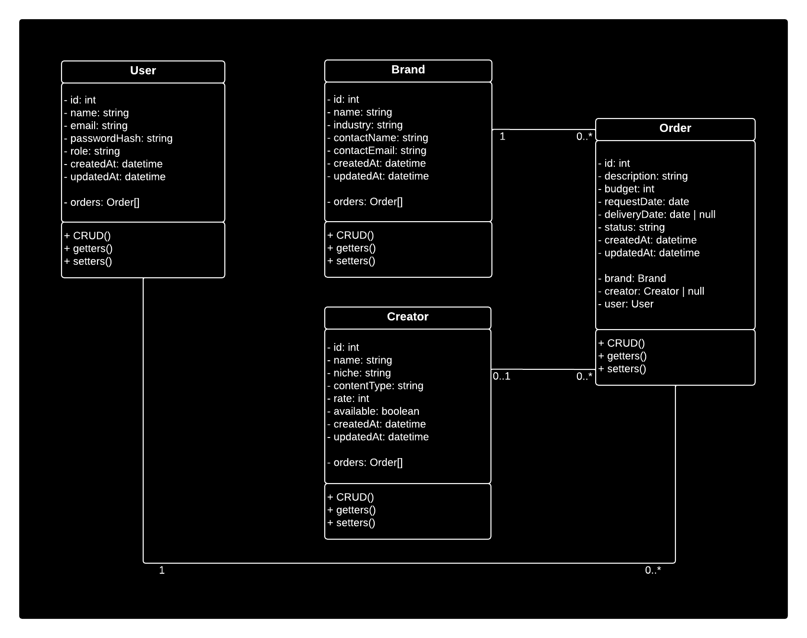
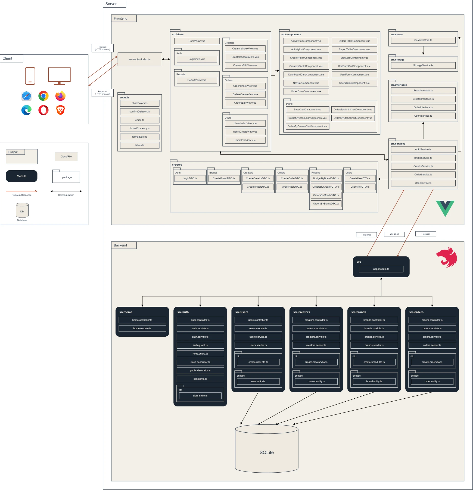
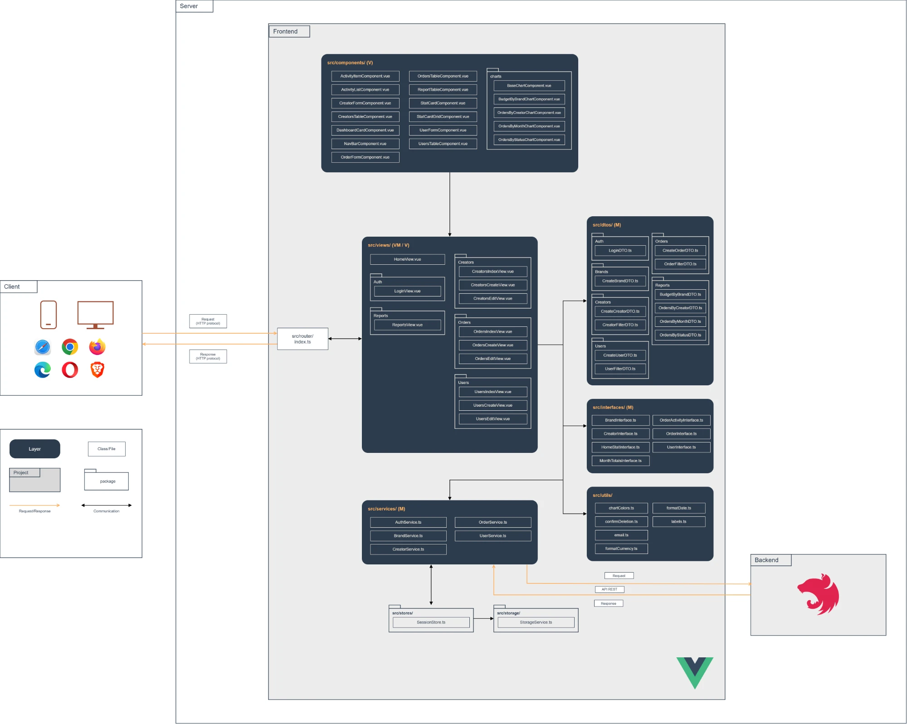
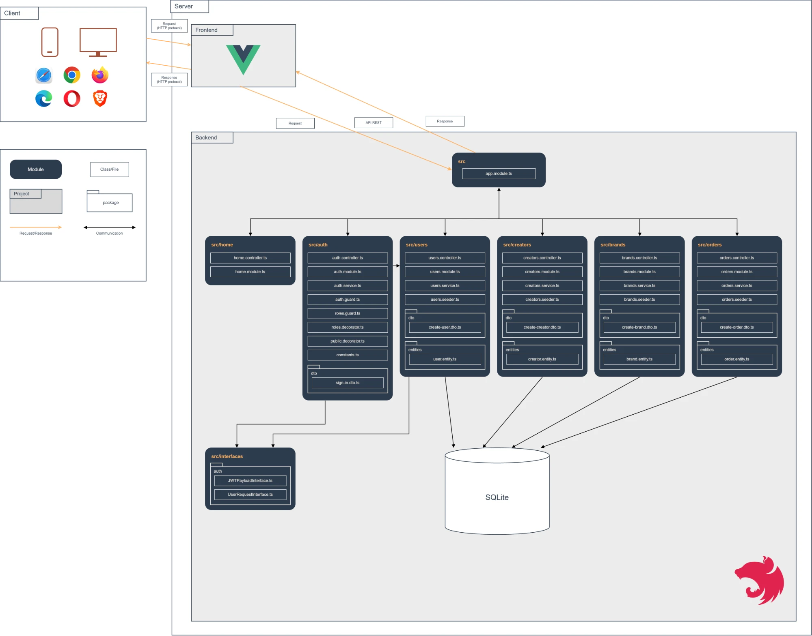

# Class Diagram

The four domain classes the backend persists, one TypeORM entity and one NestJS module each: **User** (admin or coordinator), **Brand** (who requests the content), **Creator** (who produces it) and **Order** (the unit of work that connects them, with a budget and a five-step status). An Order always has one Brand and one coordinator User, and has at most one Creator until it is assigned.

# General Architecture Diagram

The browser loads the Vue SPA from nginx and then talks to the NestJS REST API (`/api`) with JSON and a JWT in the `Authorization` header. The API is the only part that touches the SQLite database. Both projects run as containers on the GCP VM (`docker-compose.yml`).

# Frontend Architecture Diagram

Router (with the access guard) → views (pages) → reusable components through props and events. Views call the services, the only layer that makes HTTP requests. The session (token + current user) is the only Pinia store, persisted through `StorageService`.

# Backend Architecture Diagram

One NestJS module per domain class, plus `auth` and `home`. Every request passes through the global `AuthGuard` (valid JWT) and `RolesGuard` (`@Roles('admin')`), then controller → service (validation and domain rules) → TypeORM repository → SQLite. Seeders insert the demo data when a table is empty.

**Layer-by-layer explanation, editable text diagrams and known limitations:** see [Architecture](https://github.com/kepabonsaeafit/creatorly/wiki/Architecture).
